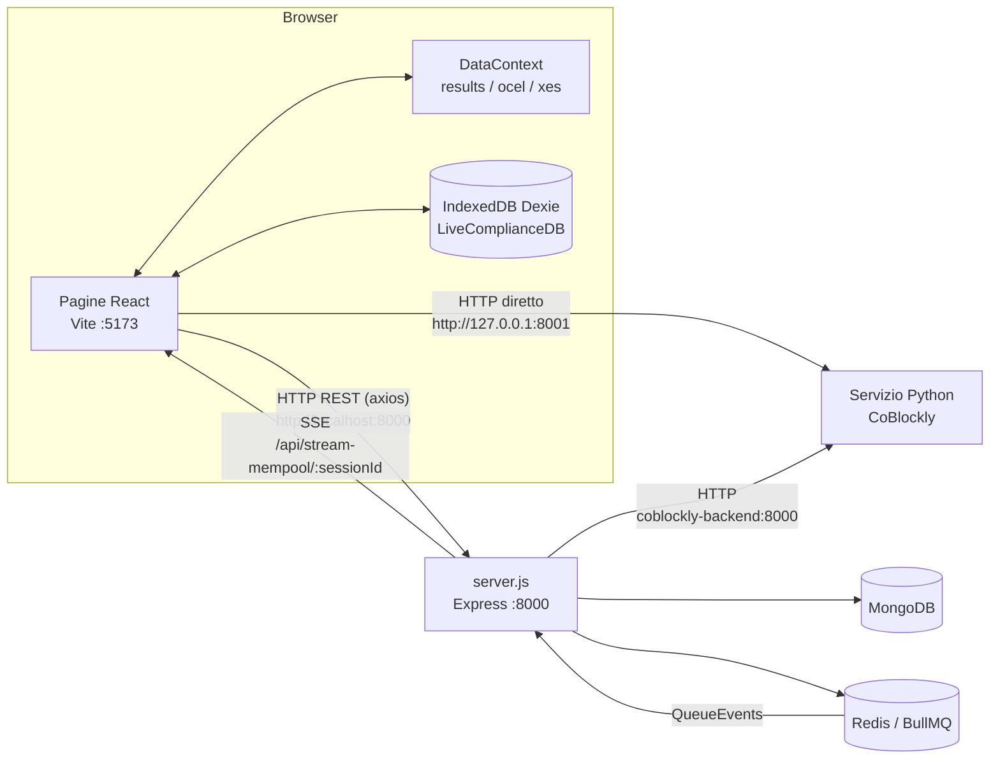
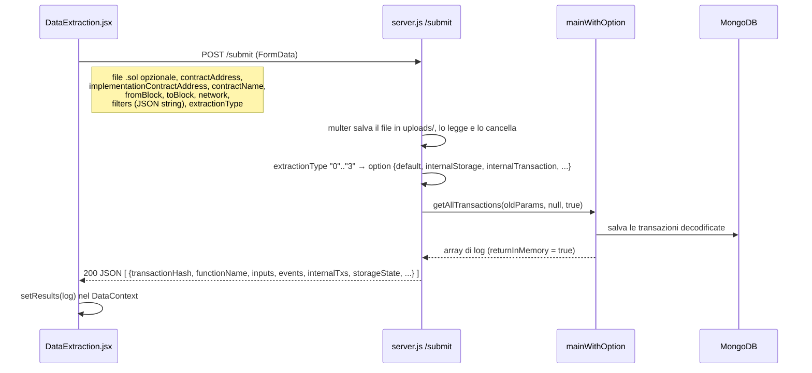
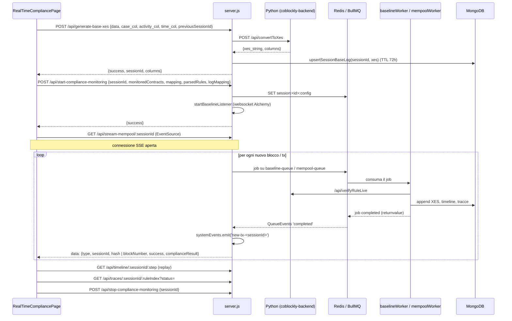

# Interazione tra backend e frontend

Questo documento spiega come il frontend React (`BlockchainProcessMining_frontend`) comunica con questo backend Express (`BlockchainDataExtraction`). Per la struttura interna del backend vedi `panoramica_generale_progetto.md`.

---

## 1. Vista d'insieme



Il frontend usa tre canali:

| Canale | Direzione | Uso |
|---|---|---|
| **REST via axios** verso `http://localhost:8000` | FE → BE | Quasi tutto: estrazione, export, query, mapping, simulazione, avvio e stop della compliance. |
| **Server-Sent Events** (`EventSource`) | BE → FE | Risultati della compliance in tempo reale, una riga per blocco o transazione elaborata. |
| **REST diretto verso il servizio Python** `http://127.0.0.1:8001` | FE → Python | Solo la pagina *Compliance* (CoBlockly): upload del log e verifica delle regole. Questo traffico **non passa dal backend Node**. |

Non ci sono autenticazione, token o sessioni utente. Il backend abilita CORS per tutte le origini (`app.use(cors())`) e accetta body JSON fino a 700 MB (`bodyParser.json({ limit: "700mb" })`), perché il frontend rimanda spesso al server l'intero log estratto.

---

## 2. Configurazione lato frontend

- **URL del backend**: è hardcoded in `src/api/services.js` come `const serverUrl = "http://localhost:8000"`. Non esistono variabili d'ambiente Vite (`import.meta.env`).
- **URL duplicati**: diversi componenti non passano da `services.js` e chiamano `http://localhost:8000/...` direttamente con axios o `EventSource`:
  - `components/dataVisualization/dialogs/*Dialog.jsx` (`/api/data/*`, `/api/collections`)
  - `pages/VisualModel.jsx`, `pages/SankeyComponent.jsx` (`/api/collections`, `/api/transactions`)
  - `pages/RealTimeCompliancePage.jsx` (SSE)
  - `pages/CoBlockly/**` (servizio Python su `127.0.0.1:8001`)

  Per cambiare host o porta del backend vanno quindi modificati tutti questi file, non solo `services.js`.
- **Avvio**: frontend con `npm run dev` (Vite, porta 5173; il `Dockerfile` usa `--host`), backend con `npm run dev` / `npm start` sulla porta 8000. Il README del frontend cita `npm run start`, ma quello script non esiste più in `package.json`.
- **Stato client**:
  - `context/DataContext.jsx` tiene in memoria l'ultimo log estratto (`results`), l'OCEL generato (`ocel`) e l'XES (`xes`). Le pagine di mapping ed export lavorano su questo stato e lo rimandano al backend.
  - `react-query` gestisce cache e refetch delle chiamate di lettura (`/api/data`, `/api/collections`, `/api/transactions`).
  - `dexie.js` crea il database IndexedDB `LiveComplianceDB` (tabella `history`), che conserva lato browser lo storico della compliance live.

---

## 3. Mappa pagine → endpoint

| Pagina / componente FE (route) | Funzione FE | Endpoint BE | Logica BE |
|---|---|---|---|
| `HomePage`, `DataExtraction` (`/data-extraction/extraction`) | `_sendData({oldParams})` | `POST /submit` (multipart) | `mainWithOption.getAllTransactions(oldParams, null, true)` |
| `DataExtractionInternal` (`/data-extraction/extractionInternal`) | `_sendData({newParams})` | `POST /submit` (multipart) | `getAllTransactions(null, newParams, false)` |
| `PageLayout` (bottoni di download) | `_downloadJson`, `_downloadCSV`, `_xesDownload`, `_downloadOCEL`, `_downloadJSONOCEL`, `_downloadCSVOCEL` | `POST /json-download`, `/csv-download`, `/xes-translator`, `/ocel-download`, `/jsonocel-download`, `/csvocel-download` | conversione in-process, file temporaneo, risposta `blob` |
| `QueryPageLayout` | `_downloadJson` | `POST /json-download` | come sopra |
| `OcelMapping` (`/data-mapping/ocel`) | `_occelMapping` | `POST /api/ocelMap` | `ocelMapping/eventTypes` + `setObjectTypes` |
| `XesPage` (`/data-mapping/xes`) | `_ocelXes` | `POST /api/xes` | `jsonToXes` |
| `Query` (`/data-analysis/query`) | `_searchTransactionByQuery` | `POST /api/query` | `query/query.searchTransaction` sulla rete scelta |
| `DataView` (`/data-analysis/view`) | `getData`, `importJSONToDB` | `POST /api/data?type=...`, `POST /api/uploadDataInDb` | `query/query.queryData`, insert per collection |
| Dialog della dashboard (`ActivityDialog`, `TransactionsDialog`, `EventsDialog`, `CallsDialog`, `TransactionDialog`, `StorageHistoryDialog`, `FilterDialog`) | axios diretto | `POST /api/data/activities`, `/txs`, `/events`, `/internalTxs`, `/internalTxsTree`, `/storageState`; `GET /api/collections` | query MongoDB con paginazione (`page`, `limit`) |
| `VisualModel` (`/data-analysis/visual`) | `_generateGraph` + axios | `GET /api/collections`, `POST /api/transactions`, `POST /api/generateGraph` | filtro MongoDB, costruzione di nodi e archi |
| `SankeyComponent` (`/data-analysis/sankey`) | axios diretto | `GET /api/collections`, `POST /api/transactions` | filtro MongoDB |
| `SimulationPage` (`/data-extraction/simulation`) | `_simulateTransaction` | `POST /api/simulate` | `simulationOrchestrator.processSimulation` |
| `MempoolSimulationPage` (`/data-extraction/mempool-simulation`) | `_getMempoolTxs`, `_simulateMempoolTxs` | `GET /api/get-mempool-txs?limit=`, `POST /api/simulate/mempool-txs` | `mempoolSimulator` |
| `XesConverter` (dentro le pagine di compliance) | `_getCollections`, `_getTransactionsFromDb`, `_convertLogsToXes` | `GET /api/collections`, `POST /api/transactions`, `POST /api/generate-base-xes` | proxy verso Python `convertToXes`, crea `sessionId` |
| `RealTimeCompliancePage` (`/data-analysis/real-time-compliance`) | `_startComplianceMonitoring`, `_stopComplianceMonitoring`, `_getTimelineStep`, `EventSource` | `POST /api/start-compliance-monitoring`, `POST /api/stop-compliance-monitoring`, `GET /api/timeline/:sessionId/:stepIndex`, `GET /api/stream-mempool/:sessionId` (SSE) | `mempoolListener.startBaselineListener`, BullMQ, `QueueEvents` |
| `RangeCompliance` (`/data-extraction/range-compliance`) | `_startHistoricalAnalysis`, `_getTimelineStep` | `POST /api/start-historical-analysis`, `GET /api/timeline/...` | `mockMonitoring.runHistoricalCompliance` (in background) |
| `LiveComplianceViewer` / `TraceViewer` | `_getRuleTraces` | `GET /api/traces/:sessionId/:ruleIndex?status=` | `getResolvedTraces` (MongoDB) |
| `CoBlocklyPage` (`/data-analysis/coblockly`) | axios diretto | **Python** `POST 127.0.0.1:8001/api/uploadLog`, `/api/verifyRule` | non passa dal backend Node |

Endpoint del backend che il frontend **non** usa: `POST /submitInternal` (sostituito da `/submit` con `contractAddressesFrom`), `GET /`, `/about`, `/user/:id`, `POST /api/data/calls`, `POST /api/test-extraction`, `POST /api/test-append-xes` (questi ultimi due servono per test manuali).

---

## 4. Flussi principali

### 4.1 Estrazione storica



- La richiesta è **sincrona e lunga**: la risposta HTTP arriva solo a estrazione finita (un `fork()` per transazione). Non c'è avanzamento in tempo reale.
- Il form "classico" (`oldParams`) e quello "internal" (`newParams`, con `contractAddressesFrom` / `contractAddressesTo` come stringhe JSON) usano lo **stesso endpoint**. Il backend li distingue dalla presenza di `contractAddress` oppure di `contractAddressesFrom`.
- Nel ramo `newParams` il backend chiama `getAllTransactions(null, params, false)`, cioè **senza** `returnInMemory`. I dati finiscono su MongoDB, ma la risposta al frontend è un array vuoto. Per vederli bisogna passare dalla dashboard o dalle query.
- La rete (`network`) arriva dal form e determina il database `${network}_DB`.

### 4.2 Mapping ed export (stateless)

Dopo l'estrazione il log resta nel `DataContext` del browser. Le pagine OCEL, XES ed export **rimandano tutto il log** al backend, che lo trasforma senza leggere da MongoDB:

1. `POST /api/ocelMap` con `{ objectsToMap, blockchainLog }` restituisce `{ eventTypes, objectTypes, events, objects }`. Il frontend lo salva con `setOcel`.
2. `POST /api/xes` con `{ objectsToXes: {caseId, activityKey, timestamp}, jsonToXes }` restituisce `{ xesString }`.
3. Gli endpoint `*-download` ricevono `{ jsonLog }` o `{ ocel }`. Il backend scrive un file temporaneo nella root del progetto e lo invia con `Content-Disposition: attachment`; il frontend lo riceve come `responseType: 'blob'` e avvia il download.

Questo è il motivo del limite di 700 MB sul body JSON. Gli endpoint di download usano nomi di file fissi (`jsonLog.json`, `jsonLog.csv`, ...), quindi due download contemporanei possono sovrascriversi a vicenda.

### 4.3 Analisi sui dati salvati (dashboard, grafo, Sankey, query)

- `GET /api/collections` restituisce i nomi delle collection, una per contratto (indirizzo in minuscolo). Il frontend li mostra come filtro.
- `POST /api/transactions` riceve `{ selectedCollection[], contractAddress[], dateFrom, dateTo, fromBlock, toBlock, funName, sender, minGasUsed, maxGasUsed }` e restituisce le transazioni concatenate da tutte le collection selezionate. È usato dal grafo, dal Sankey e dal convertitore XES della compliance.
- `POST /api/data?type=<tab>` alimenta i tab della dashboard (`DataView`); il `type` sceglie l'aggregazione in `query/query.queryData`.
- `POST /api/data/<dettaglio>` alimenta i dialog di drill-down. I parametri viaggiano in query string (`activity`, `sender`, `eventName`, `txHash`, `callId`, `variableName`, `page`, `limit`, `sampleRate`), i filtri nel body.
- `POST /api/query` (pagina Query) è l'**unico** endpoint di lettura che riceve la rete dal frontend (`network` nel body).
- `POST /api/uploadDataInDb` riceve `{ jsonLog }`, dove `jsonLog` è **il testo** del file JSON (letto con `FileReader`) e non un oggetto. Il backend fa `JSON.parse`, normalizza `_id.$oid` e `timestamp.$date` (formato export di MongoDB) e inserisce ogni documento nella collection del suo `contractAddress`.

> **Nota sulla rete**: tutti gli endpoint `/api/data*`, `/api/collections`, `/api/transactions`, `/api/uploadDataInDb`, la simulazione e la compliance chiamano `connectDB("Mainnet")` in modo fisso. Solo `/submit` e `/api/query` rispettano la rete scelta dall'utente. Dato che la connessione mongoose è unica e globale, una query su Sepolia seguita da una richiesta della dashboard fa tornare l'intero processo su Mainnet.

### 4.4 Simulazione

- **Singola transazione** (`SimulationPage`): `POST /api/simulate` con `{ params: [ { from, to, data, value, gas, ... }, blockTag? ] }`, cioè lo stesso formato dei parametri di `eth_call`. Restituisce il trace decodificato. In caso di errore risponde `400 { error, logs }` e il frontend mostra i `logs` nella console di simulazione.
- **Mempool** (`MempoolSimulationPage`):
  1. `GET /api/get-mempool-txs?limit=N` (massimo 500) apre un websocket Alchemy, raccoglie N transazioni pendenti e risponde `{ success, network, count, data }`.
  2. L'utente seleziona le transazioni e le invia con `POST /api/simulate/mempool-txs` `{ transactions: [...] }`, che risponde `{ success, totalProcessed, data }`.

  Entrambe le chiamate sono sincrone e non usano code né SSE.

### 4.5 Compliance in tempo reale (REST + SSE)

È l'unico flusso con comunicazione **push** dal backend al frontend.



**Fasi lato frontend:**

1. **Base XES** (`XesConverter`): l'utente carica un JSON o sceglie dati dal DB (`/api/collections` + `/api/transactions`), poi definisce il mapping `case_col` / `activity_col` / `time_col`. Il backend svuota `internalTxs` ed `events` per alleggerire il log, lo inoltra al servizio Python e genera un `sessionId` (UUID) che il frontend conserva per tutte le chiamate successive. Se esiste un `previousSessionId`, la sessione precedente viene cancellata.
2. **Regole**: scritte e parsate nel browser (grammatica nearley in `pages/CoBlockly`) e inviate come `parsedRules`. Il `logMapping` traduce i nomi dei campi del log (es. `SV` → `storageState`, `CALL` → `internalTxs`).
3. **Avvio**: `POST /api/start-compliance-monitoring` salva la configurazione su Redis e avvia il listener dei blocchi per i contratti monitorati.
4. **Stream**: il frontend apre `new EventSource("http://localhost:8000/api/stream-mempool/<sessionId>")`. Ogni messaggio è JSON con uno di questi due formati:

   ```json
   { "type": "BASELINE_UPDATE", "sessionId": "...", "blockNumber": 123, "success": true, "complianceResult": [...] }
   { "type": "SIMULATION_RESULT", "sessionId": "...", "hash": "0x...", "complianceResult": [...] }
   ```

   Il frontend scarta i duplicati (`hash` oppure `Block_<n>` in un `Set`), ignora i blocchi con `success: false` (mostrando una notifica "blocco vuoto"), incrementa uno step counter e mostra il risultato più recente.
5. **Replay**: in modalità playback il frontend chiede `GET /api/timeline/:sessionId/:stepIndex` per rileggere da MongoDB lo snapshot di uno step passato. `GET /api/traces/...` restituisce le tracce compliant o non compliant di una regola.
6. **Stop**: il frontend chiude l'`EventSource` e chiama `POST /api/stop-compliance-monitoring`.

**Requisiti perché lo stream funzioni:** Redis attivo, `mempoolWorker.js` e `baselineWorker.js` avviati come processi separati, servizio Python raggiungibile all'hostname `coblockly-backend` (rete Docker). Il server Express riceve l'esito dai worker tramite `QueueEvents` di BullMQ e lo inoltra all'`EventEmitter` in-process `config/sse.js`, che scrive sulla connessione SSE.

### 4.6 Compliance storica (range di blocchi)

`RangeCompliance` usa lo stesso base XES e lo stesso `sessionId`, poi chiama `POST /api/start-historical-analysis` con `{ sessionId, monitoredContracts, mapping, parsedRules, logMapping, fromBlock, toBlock }`. Il backend avvia `runHistoricalCompliance` **senza `await`** e risponde subito. Non c'è uno stream SSE: il frontend consulta i risultati a richiesta, uno step alla volta, con `GET /api/timeline/:sessionId/:stepIndex`.

### 4.7 CoBlockly (compliance offline)

La pagina `/data-analysis/coblockly` parla **direttamente** con il servizio Python su `http://127.0.0.1:8001`:
- `POST /api/uploadLog` (multipart) carica il log
- `POST /api/verifyRule` con `{ rule, mapping }` verifica una regola

Il backend Node non è coinvolto. Il servizio Python quindi viene raggiunto con due indirizzi diversi: `127.0.0.1:8001` dal browser e `coblockly-backend:8000` dal backend in Docker.

---

## 5. Convenzioni e formati

| Aspetto | Comportamento |
|---|---|
| Formato richieste | JSON per quasi tutto; `multipart/form-data` solo per `/submit` (campo `file`). Nel multipart oggetti e array (`filters`, `contractAddressesFrom/To`) sono inviati come stringhe JSON e il backend li riparsa. |
| Formato risposte | Non uniforme. Alcuni endpoint restituiscono dati "nudi" (array o oggetto), altri `{ success, data | error }`. |
| Gestione errori FE | Le funzioni di `services.js` spesso catturano l'errore e restituiscono `{ status, data }`; quelle più recenti (compliance, collections, transactions) lasciano propagare l'eccezione axios al chiamante. |
| Download | `responseType: 'blob'`; il nome del file arriva in `Content-Disposition`. |
| Timeout | Nessun timeout impostato su axios: le estrazioni lunghe tengono la richiesta aperta finché il backend non risponde. |
| Identità della sessione di compliance | `sessionId` UUID generato dal backend in `/api/generate-base-xes`; il frontend lo usa per SSE, timeline, tracce e stop. |

---

## 6. Criticità note nell'integrazione

1. **URL hardcoded** (`localhost:8000`, `127.0.0.1:8001`) sparsi in molti file del frontend: non si può fare il deploy su un altro host senza modificare il codice.
2. **Rete fissa a Mainnet** nella maggior parte degli endpoint di lettura, simulazione e compliance, anche se il frontend offre la scelta della rete.
3. **Listener SSE mai rimosso**: in `/api/stream-mempool/:sessionId` il blocco `req.on('close', ...)` è commentato. Ogni riconnessione aggiunge un listener a `systemEvents` per lo stesso `sessionId`, quindi gli eventi arrivano duplicati (il frontend li filtra lato client) e i listener si accumulano in memoria.
4. **Estrazione "internal" senza risposta**: `/submit` con `contractAddressesFrom` restituisce `[]` perché non usa `returnInMemory`.
5. **File temporanei a nome fisso** negli endpoint di download: le richieste concorrenti possono sovrascriversi a vicenda.
6. **`/api/uploadDataInDb`** risponde con `res.send(200)` (sintassi deprecata) e poi chiama `mongoose.disconnect()`, chiudendo la connessione globale anche per eventuali richieste in corso.
7. **Payload enormi**: OCEL, XES ed export rimandano al server l'intero log tenuto nel browser invece di riferirsi ai dati già presenti su MongoDB.
