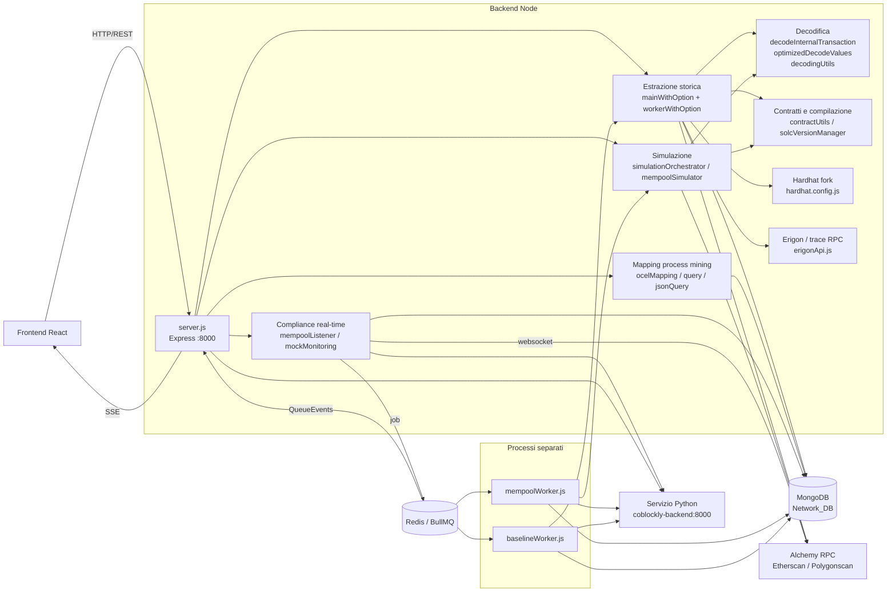
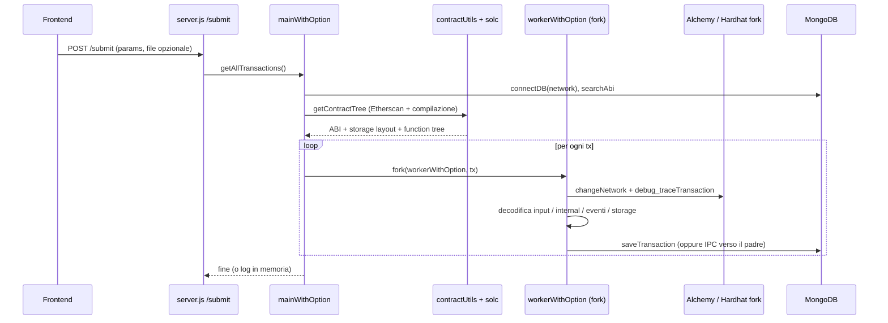
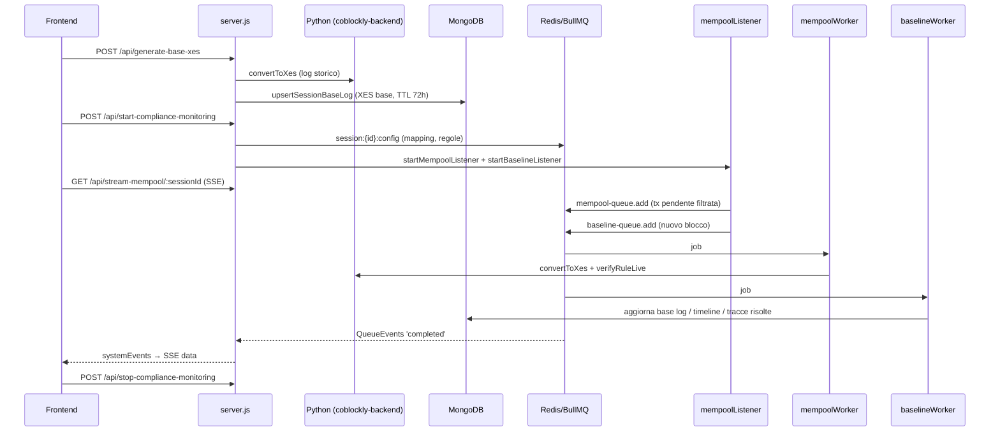
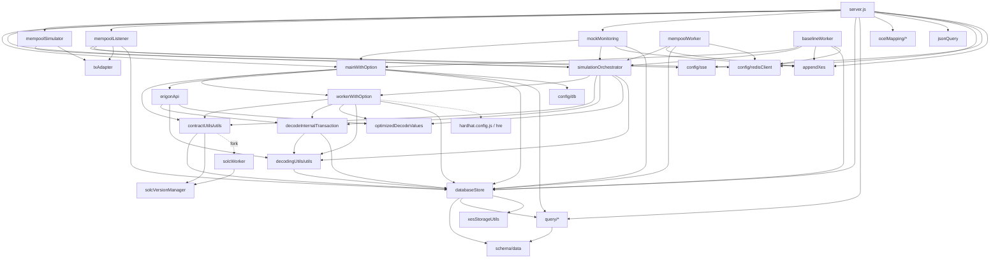

# Panoramica generale del progetto: BlockchainDataExtraction

Backend Node.js/Express (CommonJS) per il **process mining su blockchain**. Fa quattro cose:

1. **Estrazione storica**: recupera le transazioni di uno o più smart contract, le ri-esegue in trace e le decodifica (input, chiamate interne, eventi, variazioni di storage).
2. **Persistenza**: salva tutto su MongoDB, con un database per ogni rete.
3. **Export per il process mining**: JSON, CSV, OCEL (JSON/CSV), XES, oltre a query e grafi sui dati salvati.
4. **Simulazione e compliance in tempo reale**: simula le transazioni pendenti nella mempool con `debug_traceCall` e le verifica contro regole di compliance (tramite un servizio Python esterno). Usa Redis/BullMQ e invia aggiornamenti al frontend via SSE.

Il frontend React vive in un altro repository (`BlockchainProcessMining_frontend`).

---

## 1. Vista d'insieme

---

## 2. Macro blocchi

### 2.1 Entry point e API HTTP

| File | Ruolo |
|---|---|
| `server.js` (~1750 righe) | Contiene **tutte** le route Express in un solo file (non ci sono router separati). Gestisce upload (multer), CORS, body parser, export e SSE. Porta 8000 fissa. |
| `public/index.html` | Pagina statica minima. |
| `hardhat.config.js` | Configura Hardhat ed estende l'ambiente con `hre.changeNetwork(network, blockNumber)`, che ripunta il fork Hardhat sulla rete o sul blocco richiesto (URL Alchemy presi dal `.env`). |
| `Dockerfile` | Immagine node:22-alpine, espone 8000, avvia `npm start` (`node --expose-gc server.js`). |

Gruppi di endpoint in `server.js`:

| Gruppo | Endpoint | Chiama |
|---|---|---|
| Estrazione | `POST /submit`, `POST /submitInternal` | `mainWithOption.getAllTransactions` |
| Export | `/json-download`, `/csv-download`, `/ocel-download`, `/jsonocel-download`, `/csvocel-download`, `/xes-translator` | conversioni in-process (json-2-csv, csv-stringify) e file temporanei |
| Mapping/visualizzazione | `/api/ocelMap`, `/api/xes`, `/api/generateGraph`, `/api/query` | `ocelMapping/*`, `jsonQuery`, `query/flattenTransaction` |
| Query su DB | `/api/data`, `/api/data/{activities,txs,events,internalTxs,internalTxsTree,calls,storageState}`, `/api/collections`, `/api/transactions`, `/api/uploadDataInDb` | `query/query.js`, `query/queryFunctions.js`, `query/transactionQuery.js` |
| Simulazione | `/api/simulate`, `/api/get-mempool-txs`, `/api/simulate/mempool-txs` | `simulationOrchestrator`, `mempoolSimulator` |
| Compliance | `/api/generate-base-xes`, `/api/start-compliance-monitoring`, `/api/stop-compliance-monitoring`, `/api/stream-mempool/:sessionId` (SSE), `/api/traces/:sessionId/:ruleIndex`, `/api/timeline/:sessionId/:stepIndex`, `/api/start-historical-analysis` | `mempoolListener`, `mockMonitoring`, `databaseStore`, servizio Python |
| Test ad hoc | `/api/test-extraction`, `/api/test-append-xes` | usati per verificare le modifiche a mano (non esiste una test suite) |

---

### 2.2 Configurazione e infrastruttura

| File | Ruolo |
|---|---|
| `config/db.js` | `connectDB(network)`: chiama `mongoose.disconnect()` e poi riconnette a `${MONGODB_URL}/${network}_DB`. **La connessione è unica e globale**: cambiare rete vale per tutto il processo. |
| `config/redisClient.js` | Client ioredis, code BullMQ `mempool-queue` (`txQueue`) e `baseline-queue`, più i rispettivi `QueueEvents`. |
| `config/sse.js` | Un `EventEmitter` in-process (`systemEvents`) che fa da ponte tra eventi interni e connessioni SSE. |
| `.env` / `localEnv` | Variabili d'ambiente: MongoDB, Alchemy (HTTP e WS), Etherscan/Polygonscan, Redis. `localEnv` è il template versionato. |

---

### 2.3 Persistenza (MongoDB)

| File | Ruolo |
|---|---|
| `schema/data.js` | Tutti gli schemi Mongoose: `transactionSchema` (transazione estratta), `extractionLogSchema`, `extractionAbiSchema` (ABI e contratto compilato), `extractionMetricsSchema`, `baselineWorkerMetricsSchema`, `singleTraceSchema` e gli schemi di sessione per la compliance (`sessionBaseLogMeta`, `sessionBaseTrace`, `sessionTimelineStep`, `sessionTimelineTrace`, `sessionResolvedTrace`, `sessionRuleBlacklist`). |
| `databaseStore.js` | Unico punto di **scrittura** e helper di persistenza: `saveTransaction`, `saveAbi`, `saveCompiledContractData`, metriche, XES base di sessione salvato a chunk con TTL (`upsertSessionBaseLog` / `getSessionBaseLog`), timeline, tracce risolte, blacklist e `deleteSessionComplianceState`. |
| `query/query.js` | Lettura: `searchTransaction`, `searchAbi`, `queryData` e `getModelByContractAddress`, che crea **una collection per ogni contratto** (il nome della collection è l'indirizzo). |
| `services/simulationUtils/xesStorageUtils.js` | Divide e ricompone stringhe XES grandi in chunk (per il limite di 16MB dei documenti Mongo), estrae header e trace e ricava il caseId. |

Organizzazione dei dati: un database per rete (`Mainnet_DB`, `Sepolia_DB`, `Polygon_DB`, `Amoy_DB`), al cui interno ci sono:
- una collection per ogni contratto con le transazioni estratte;
- collection di servizio: `ContractData`, `ExtractionLog`, `ExtractionMetrics`, `BaselineWorkerMetrics`, `SingleTraces`, `Session*`.

---

### 2.4 Pipeline di estrazione storica (il cuore del sistema)

| File | Ruolo |
|---|---|
| `services/ExtractionModule/mainWithOption.js` | Orchestratore. `getAllTransactions(oldParams, newParams, returnInMemory)` sceglie la rete (`networkData`), si connette al DB, ottiene il contract tree e per ogni transazione esegue un **processo figlio** (`fork`) con `workerWithOption.js`. |
| `services/ExtractionModule/workerWithOption.js` (~1600 righe) | Lavora su una singola transazione: trace (`debug_traceTransaction` via fork Hardhat oppure streaming RPC stile Erigon), decodifica degli input, eventi, chiamate interne e storage, poi salvataggio con `saveTransaction` o ritorno al padre via IPC. |
| `services/Erigon/erigonApi.js` | `buildTransactionHierarchy` (usa `trace_filter` per trovare le transazioni tra insiemi di indirizzi from/to), streaming di `debug_traceTransaction`, receipt ed eventi. |
| `services/decodeInternalTransaction.js` | Ricostruisce e decodifica l'albero delle chiamate interne (CALL, DELEGATECALL, ...), con ABI recuperate al volo. |
| `services/optimizedDecodeValues.js` | Decodifica i valori di storage (SSTORE/SHA3 → variabili, mapping e array) usando lo storage layout del compilatore. |
| `services/decodingUtils/utils.js` | Utility comuni: decodifica degli input, estrazione degli eventi (da Hardhat, da Erigon o dalle chiamate interne). |

Le due modalità di `getAllTransactions`:
- **oldParams** (un contratto con intervallo di blocchi): recupera le transazioni del contratto (`getTransactionFromContract`), costruisce il contract tree e chiama `getStorageData`.
- **newParams** (insiemi di indirizzi from/to): `buildTransactionHierarchy` tramite `trace_filter`, poi per ogni transazione recupera ABI e contract tree e chiama `getStorageData`.

L'oggetto `option` (ad esempio `{ default, internalStorage, internalTransaction }`) decide quali parti estrarre. Con `returnInMemory = true` i risultati non vanno su DB ma vengono restituiti al chiamante (è il caso di `baselineWorker` e `mockMonitoring`).

---

### 2.5 Recupero e compilazione dei contratti

| File | Ruolo |
|---|---|
| `services/contractUtils/utils.js` | `getContractCodeEtherscan` (sorgente da Etherscan/Polygonscan), `getCompiledData`, `getContractTree` (ABI + variabili di storage + funzioni), `compileInChildProcess`. |
| `services/contractUtils/solcWorker.js` | Processo figlio che esegue la compilazione `solc`, così il server non si blocca e gli errori restano isolati. |
| `services/solcVersionManager.js` | Scarica e memorizza in cache la versione di `solc` richiesta dal contratto. |

Il contratto compilato viene salvato in `ContractData` (`saveAbi` / `saveCompiledContractData`) e riusato nelle estrazioni successive.

---

### 2.6 Mapping per il process mining e query

| Cartella / File | Ruolo |
|---|---|
| `ocelMapping/eventTypes.js` | Definisce gli event type OCEL a partire dal log blockchain. |
| `ocelMapping/objectTypes/objectTypes.js`, `setObjectTypes.js` | Definiscono gli object type OCEL e li popolano. |
| `ocelMapping/objectTypes/objRelationships/addRelationships.js` | Relazioni tra oggetti OCEL. |
| `query/queryFunctions.js` (~1000 righe) | Funzioni che servono gli endpoint `/api/data/*` (attività, eventi, internal txs, albero delle chiamate, storage state). |
| `query/flattenTransaction.js` | Appiattisce una transazione annidata (usato da `/api/generateGraph`). |
| `query/transactionQuery.js`, `query/filter.js` | Query filtrate sulle transazioni (`/api/transactions`). |
| `jsonQuery/jsonQuery.js` | Query JSONPath sui log (`/api/query`). |

---

### 2.7 Simulazione di transazioni non minate

| File | Ruolo |
|---|---|
| `services/ExtractionModule/simulationOrchestrator.js` | `processSimulation(params, targetAddress, networkData, hash)` esegue `debug_traceCall` su una transazione non minata e la decodifica come la pipeline storica, **riusando funzioni di `workerWithOption`**. Contiene anche dei mock (`mockProcessSimulation`, `mockExtraction`). |
| `services/ExtractionModule/mempoolSimulator.js` | `getMempoolTxs` legge le transazioni pendenti, `simulateMempoolTxs` le simula in serie. |
| `services/simulationUtils/txAdapter.js` | `adaptMempoolTx` converte una transazione della mempool nel formato dei parametri RPC di `debug_traceCall`. |
| `services/simulationUtils/logger.js` | Log di sistema della simulazione. |

---

### 2.8 Compliance in tempo reale (Redis + BullMQ + SSE)

| File | Processo | Ruolo |
|---|---|---|
| `services/realTimeCompliance/mempoolListener.js` | server | `startMempoolListener` si iscrive via websocket a `newPendingTransactions`, filtra per indirizzo e accoda in `mempool-queue`. `startBaselineListener` si iscrive ai nuovi blocchi e accoda in `baseline-queue`. `stopMempoolListener` chiude la sessione. |
| `services/realTimeCompliance/mempoolWorker.js` | **separato** | Consuma `mempool-queue`: `processSimulation`, poi Python `/api/convertToXes`, poi `appendXes` sull'XES base di sessione, poi Python `/api/verifyRuleLive`. Restituisce l'esito di compliance. |
| `services/realTimeCompliance/baselineWorker.js` | **separato** | Consuma `baseline-queue`: quando viene minato un blocco estrae le transazioni reali (`getAllTransactions(..., returnInMemory=true)`), le converte in XES, aggiorna l'XES base e la timeline, e risolve le tracce pendenti contro le regole. |
| `services/realTimeCompliance/mockMonitoring.js` | server (in background) | `runHistoricalCompliance` ripete su dati storici lo stesso flusso, per test e valutazione (`/api/start-historical-analysis`). |
| `services/simulationUtils/appendXes.js` | condiviso | Unisce un mini-XES (singola transazione) all'XES base e restituisce il mini-XES da verificare. |
| `services/simulationUtils/performanceMetrics.js` | condiviso | Scrive le metriche di performance su file. |

Ciclo di vita di una sessione di compliance:

Lo stato della sessione è diviso in due:
- **Redis**: configurazione della sessione (`session:{id}:config`) e code dei job;
- **MongoDB**: XES base a chunk, timeline per step, tracce risolte per regola, blacklist dei caseId. È leggibile da `/api/traces` e `/api/timeline`.

---

### 2.9 File legacy e artefatti (fuori dal codice attivo)

- `index.js`, `internal.js`: versioni precedenti dell'estrattore.
- `prova12`, `sourceCode`, `solcOutput`, `testContract.json`, `solcFiles/`: output e campioni di debug.
- `outputLogs/`, `temporaryTrials/`: log e prove.
- `query/exampleTransaction.json`: esempio della struttura di una transazione estratta, utile come riferimento del formato dati.

---

## 3. Mappa delle dipendenze tra moduli

---

## 4. Servizi esterni

| Servizio | Usato da | Per cosa |
|---|---|---|
| **Alchemy** (HTTP RPC) | estrazione, simulazione, Hardhat fork | `debug_traceTransaction`, `debug_traceCall`, `trace_filter`, `eth_*` |
| **Alchemy** (WebSocket) | `mempoolListener` | `newPendingTransactions` e nuovi blocchi |
| **Etherscan / Polygonscan** | `contractUtils`, `mainWithOption` | sorgente, ABI, informazioni sul proxy, versione del compilatore |
| **solc** (download binari) | `solcVersionManager` | compilazione con la versione corretta |
| **MongoDB** | tutto | persistenza |
| **Redis** | BullMQ, configurazione di sessione | code e stato condiviso tra server e worker |
| **Python `coblockly-backend:8000`** | server, worker, mockMonitoring | `/api/convertToXes`, `/api/verifyRuleLive`. L'hostname è **fisso nel codice** (nome Docker). |

---

## 5. Processi a runtime

| Processo | Comando | Note |
|---|---|---|
| Server API | `npm start` (o `npm run dev`) | Il flag `--expose-gc` serve perché il codice chiama `global.gc()`. |
| Worker figli per l'estrazione | creati automaticamente con `fork` | uno per transazione, heap da 4GB |
| Worker figlio solc | creato automaticamente con `fork` | compilazione |
| Mempool worker | `node services/realTimeCompliance/mempoolWorker.js` | **va avviato a mano**, serve solo per la compliance |
| Baseline worker | `node services/realTimeCompliance/baselineWorker.js` | **va avviato a mano**, serve solo per la compliance |

---

## 6. Punti di attenzione per chi inizia

- **Connessione Mongo globale**: `connectDB` disconnette e riconnette. Due richieste concorrenti su reti diverse si interferiscono a vicenda.
- **`server.js` monolitico**: ogni nuova route va lì. Le route commentate sono versioni vecchie, ad esempio un `/submit` duplicato.
- **Codice duplicato** tra `workerWithOption.js`, `simulationOrchestrator.js` ed `erigonApi.js`: `makeRpcCallStreaming`, `decodeInteralTxsStorage` e lo streaming Erigon sono ripetuti in più file. Una correzione in uno potrebbe dover essere replicata negli altri.
- **Rete fissa a Mainnet** in compliance e simulazione: worker ed endpoint compliance usano `"Mainnet"` scritto nel codice.
- **Servizio Python con hostname Docker**: in locale `coblockly-backend` non si risolve senza docker-compose o una voce in `/etc/hosts`.
- **Nessuna test suite**: per verificare una modifica si usano `/api/test-extraction` e `/api/test-append-xes`.
- Commenti e log sono per lo più in italiano.
